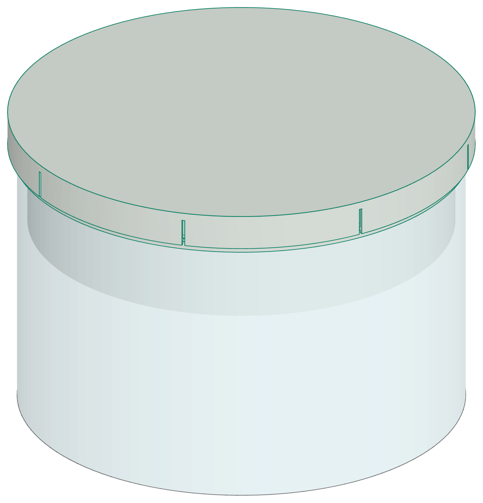

# Pink Stuff desiccant basket

<picture>
  <source media="(prefers-color-scheme: dark)" srcset="docs/hero-dark.png">
  
</picture>

A desiccant basket for the bottom half of the round West Marine -50°F antifreeze gallon jug
("the pink stuff"), and a cutting ring that cuts the jug with a razor blade. The basket holds
calcium chloride pellets (for example DampRid refills). The pellets take water from the air.
The brine drips through the open grid of the basket floor and collects in the jug.

- **Cutting ring.** A ring on three legs holds the jug centred, and holds a razor blade level
  100 mm above the table. Two 45° braces on each leg make the ring rigid. One leg braces the
  shelf. The blade sits in a cartridge on the shelf. Push the cartridge in, tighten the M2.5
  screw into the heat-set insert in the shelf, and turn the jug clockwise. The screw clamps the
  cartridge, so you do not hold it. Each jug gets the same cut.
  The blade is a single-edge razor blade with a folded steel spine: 1.5 in long, 11/16 to 3/4 in
  wide, 0.009 in thick (for example Personna #9 or Stanley 11-515). It slides into the back end
  of the cartridge, edge first. The PDF shows how to load it.
- **Collar.** A tapered groove goes over the cut edge of the jug. The edge wedges into it.
  Walls from 0.6 to 2.4 mm fit. A 45° seat above the cut holds the basket.
- **Basket.** 0.64 L of space (about 560 g of pellets), 40 mm tall. Fill it with 400 g: see "Desiccant" below. The flared rim sits on the seat. A 0.75 mm wall (one line), an
  open grid floor (2 mm openings), and a star of floor ribs. The jug holds 1.1 L of
  brine below it. Lift it out by the two finger notches in the collar.
- **Lid.** A bead in the skirt snaps over a ridge on the collar. 8 slits cut the skirt into
  wide fingers (0.6 mm snap, 1.41 % strain in PLA). The skirt also clamps the collar onto the jug.
  The plate sits on the basket rim. It is an open grid with 2 mm openings, so the pellets stay in.
- **Open grid.** The basket floor and the lid plate are solid in the model. The basket and lid
  settings (no top or bottom skin, lines infill 2.5 mm apart, connected lines) print them as an
  open grid. Each layer is one path, with no small holes. Use these settings: a normal profile
  prints a solid floor.
- No supports, no glue. White PLA, to match the pellets. The cutting ring needs one M2.5 heat-set
  insert (4 mm long, 3.6 mm hole) and one M2.5 x 12 socket head screw.

`pinkstuff-basket.pdf` has the parts list, the print settings, and the steps.

## Status

The jug diameter is **measured**: 480 mm around the middle of a sample jug, so 152.8 mm.
The 1.0 mm wall is an **estimate**. The razor blade is **measured**, except the spine depth.
The insert hole (3.6 mm) is an **estimate**: check the data sheet of your insert. Print `stl/fit_arc.stl` first. `MEASURE.md` lists the measurements to take.

## Files

| File | Content |
|---|---|
| `shape.py` | All dimensions. `ESTIMATE` marks the values that are not measured. |
| `parts.py` | The collar, the basket, the lid, the cutting ring, the cartridge, the fit test arc, and the context (the jug, the blade, the screw, the insert), in build123d. |
| `model.py` | The fit check, then `cad/*.step`, `stl/*.stl` (print orientation), and the meshes for the images. |
| `stl/` | `collar.stl`, `basket.stl`, `lid.stl`, `jig.stl`, `jig_cart.stl`, `fit_arc.stl`, in print orientation. |
| `cad/` | A STEP file for each part, `desiccant-assembly.step`, and `cutting-ring-assembly.step` (with the blade, the screw, and the insert). |
| `cura/make_profiles.py` | A Cura profile for each part, the filament use, and the support check. |
| `printdeck.yml`, `profiles/` | The Printdeck build: the parts, the TAZ Workhorse profiles, and the PDF. |
| `lineart/render.mjs` | The line-art images. |
| `printdeck_slice.py` | The Printdeck slice of each part: the print time and the filament. |
| `make_pdf.py` | The PDF. |
| `make.sh` | Runs all steps. |

## Build

```
./make.sh
```

The script stops if the fit check, the mesh check, or the support check fails. It needs `uv`,
`node`, Chromium, ImageMagick, and CuraEngine in `/opt/ultimaker-cura`.

## Print

The print times and the filament come from the Printdeck slice (`printdeck_slice.py`): the
Printdeck slicer with the TAZ Workhorse SE profile `pla-0.30-fast`, fast speeds (walls 70 and 80 mm/s, 12 mm³/s at most, 220 °C), and white
PLA (`roll-5`). The values are for one part. All parts print with a 10-line brim on the
outside. Peel the brim off after the print.

| Part | Count | Orientation | Filament | Time |
|---|---|---|---|---|
| `fit_arc.stl` | 1 | top face on the bed | 2.3 g | 6 min |
| `jig.stl` (cutting ring) | 1 | upside down, the ring top on the bed | 44 g | 1 h 56 min |
| `jig_cart.stl` (cartridge) | 1 | on its back end | 11 g | 23 min |
| `collar.stl` | 1 | top face on the bed (upside down) | 22 g | 35 min |
| `basket.stl` | 1 | floor on the bed | 26 g | 38 min |
| `lid.stl` | 1 | top face on the bed (upside down) | 14 g | 28 min |

One set (a collar, a basket, and a lid) is 62 g and 1 h 41 min. The tools (the cutting ring
and the cartridge) are 55 g and 2 h 19 min, once. The `roll-5` white PLA entry is new in
`profiles/taz-workhorse-se/cura.json`. It copies the black MatterHackers PLA settings.

## Desiccant

The open space in the basket, from the floor top to the rim top, is 0.635 L (from the solid
model, without the ribs). Calcium chloride pellets (94–97 %) have a bulk density of 52 to
58 lb/ft³ (0.83 to 0.93 g/mL). A full basket holds 530 to 590 g.

Fill it with 400 g (0.9 lb). At 70 % humidity, 1 lb of 94 % pellets takes about 2.5 lb of water.
The brine is then about 1.3 L for each pound of pellets. The jug holds 1.13 L of brine below the
basket, so 400 g is the limit. In more humid air, each pound makes more brine. Empty the jug
before the brine gets to the basket floor.
